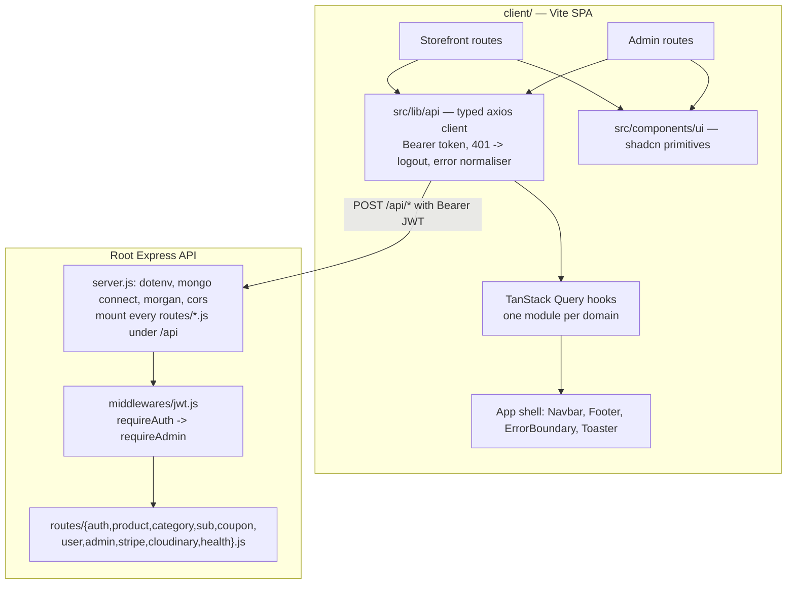

# Rebuild E-commerce Frontend

## Decisions

- **Location:** rebuild in place in `client/` — keep React 18 + Vite + TypeScript + Tailwind + shadcn-style primitives + Zustand + TanStack Query. New architecture and UI, not a new directory.
- **Scope:** full parity — storefront *and* admin (dashboard, product/category/sub/coupon CRUD, order management, refunds).
- **Backend:** targeted fixes are in scope for the contract gaps below. No payment-provider abstraction (Stripe stays as-is); the bKash swap remains a separate future task.
- **Not in scope:** the legacy Firebase auth path is removed (it is dead weight and breaks the production image). `shopflow/` is a separate project and is untouched.

## Backend findings (evidence)

These are blockers, not polish. Each one is reproduced from the source in this repo.

| # | Finding | Evidence | Effect |
|---|---|---|---|
| B1 | `server.js` does not exist | `git ls-tree HEAD` has no `server.js`; deleted in commit `56ce5c7`. `package.json` `start`/`dev` scripts, `Dockerfile` `CMD ["node","server.js"]` all point at it | The API cannot boot at all. `npm run dev`, `npm start`, and the API image all fail |
| B2 | Path-less catch-all in `routes/category.js` shadows 30 routes | `routes/category.js:49` `router.use((req,res)=>res.status(404)...)` — a `router.use()` with no path becomes a `Layer` with `path:'/'`, `end:false`, which matches **every** path (`node_modules/express/lib/router/layer.js` fast-slash branch). `category.js` mounts 3rd of 9 (`admin, auth, category, cloudinary, coupon, product, stripe, sub, user`) and its catch-all responds instead of calling `next()` | `GET /api/products/total`, `POST /api/search/filters`, `GET /api/coupons`, all cart/order/wishlist, `POST /api/create-payment-intent`, `GET /api/subs`, and every product CRUD route return `404 {"err":"Not found"}`. Only `admin.js` and `auth.js` routes survive |
| B3 | Production Docker image crashes on boot | `Dockerfile` runs `RUN rm -rf config/fbServiceAccountKey.json`; `firebase/index.js:4` does `require("../config/fbServiceAccountKey.json")` at module load; `middlewares/auth.js:1` requires it; every route file requires the middleware | `MODULE_NOT_FOUND` at boot → the API container crash-loops. The service-account JSON is also committed to git |
| B4 | `POST /api/user/profile` is called but does not exist | `client/src/api/user.ts:18` posts to `/user/profile`; `routes/user.js` has no such route | Profile and address save in the account page always fail (404) |
| B5 | Coupon contract is unusable | `controllers/user.js:141-168` returns a bare `totalAfterDiscount` string; `GET /api/user/cart` returns `{products, cartTotal, totalAfterDiscount}` with **no** `couponApplied` object | The client reads `cart.couponApplied.discount`/`.name` → always `undefined`. Coupon never displays and `couponApplied` is always `false` at payment time, so Stripe charges undiscounted |
| B6 | Empty cart 500s | `controllers/user.js:97` destructures `const {products,...} = cart` where `cart` is `null` for a user who never saved a cart | Every new user's cart page errors |
| B7 | Order creation is broken | `controllers/user.js:192` reads `Cart.findOne({orderedBy})` **without** `.populate('products.product')`, then `item.product._id` is `undefined` → `bulkWrite` filter `{_id: undefined}` → CastError | `POST /api/user/order` 500s; stock is never decremented and no order is saved |
| B8 | Search filters are first-match-wins | `controllers/product.js:395-434` runs every handler sequentially and only the first matching one responds | `POST /api/search/filters` with `{query, price, category}` returns only text-search results. Price/category/brand/color filters are ignored |
| B9 | `price` is stored as a String | `models/product.js:24-29` `price: {type: String}`; `controllers/product.js:280` `handlePrice` compares with `$gte`/`$lte` → lexicographic, so `"5"` sorts after `"100.00"` | Price filtering and sorting are wrong for mixed-magnitude prices. `models/cart.js` already expects a Number |
| B10 | Password hash leaks | `models/user.js` has no `select:false` on `password` (the controller comment at `controllers/auth.js:30-31` wrongly claims it does); `controllers/auth.js:146` `currentUser` returns the raw document | `GET /api/auth/current-user` returns the bcrypt hash to the browser |
| B11 | Admin status vocabulary mismatch | `controllers/admin.js:18-25` whitelists `Not Processed, processing, Dispatched, Cancelled, Completed, Refunded`; `client/src/pages/admin/AdminOrders.tsx:9-15` sends `Processing, Shipped, Delivered` | Every status change returns `400 Invalid orderStatus` |
| B12 | Related products never match | `controllers/product.js:240-253` reads `product.category.name` from an **unpopulated** doc → `undefined` | The related-products query matches products with an undefined category |
| B13 | Client image build is broken | `client/Dockerfile:10` `COPY nginx.conf /etc/nginx/conf.d/default.conf`, but `client/nginx.conf` does not exist (the conf lives at `deploy/nginx.conf` and is unused by compose) | The CI `docker` job fails building the client image |
| B14 | Deploy healthcheck points at a 404 | `deploy/prod.yml:35` probes `http://localhost:5000/api/`; no route serves `/api/` | The `web` service never starts in prod because `api` never becomes healthy |
| B15 | Product list is hardcoded to 3 per page | `controllers/product.js:156` `const perPage = 3` | A storefront grid can never page through the catalogue |

## Target architecture



The API client is the single seam between UI and HTTP. Every screen talks to TanStack Query hooks, never to axios directly, so error shapes, loading states, and cache invalidation stay uniform.

## Phase 0 — Backend unblock (prerequisite for any frontend work)

### T1. Restore `server.js`

Recreate the deleted entrypoint at the repo root, superseding the `56ce5c7^` version:

- `require('dotenv').config()`; `PORT` default `5000`.
- Mongo URI from `MONGO_URI`, else `mongodb://localhost:27017/<DB_NAME|ecommerce>`. When `USE_MEMORY_MONGO=1` and the primary connect fails, fall back to `scripts/mem-mongo.js` (in-process `mongodb-memory-server`) instead of crashing — `CLAUDE.md` already documents this fallback but no code implements it.
- **Listen only after the DB connects** (`CLAUDE.md` guarantees this; the deleted file connected but listened immediately).
- `morgan('dev')`, `bodyParser.json({ limit: '2mb' })` (Cloudinary base64 uploads need the 2 MB limit), `cors()`.
- Mount routes via `fs.readdirSync('./routes').map(r => app.use('/api', require('./routes/' + r)))`.
- Register the app-level JSON 404 and JSON 500 handlers **after** all routers (see T2), so the API never returns HTML.
- Keep `GET /` returning a small JSON banner so the `Dockerfile` healthcheck has something to hit.

### T2. Scope the `routes/category.js` catch-all

Delete both `router.use(...)` handlers at `routes/category.js:49` and `:56` and move equivalent handling to the app level in `server.js`:

- App-level `app.use((req, res) => res.status(404).json({ err: 'Not found' }))` — mounted last.
- App-level `app.use((err, req, res, _next) => { console.error(err); res.status(500).json({ err: 'Internal server error' }); })` — mounted last, 4-arg signature so Express treats it as an error handler.
- Verify `readdirSync` order stays `admin, auth, category, cloudinary, coupon, product, stripe, sub, user` and that all 52 endpoints now return a non-404 status.

### T3. Auth cleanup + profile endpoint

- Delete the legacy Firebase path: `firebase/`, `config/fbServiceAccountKey.json`, `middlewares/auth.js`, and the three legacy routes in `routes/auth.js` (`/create-or-update-user`, `/current-user`, `/current-admin`). Remove the now-unused `authCheck`/`adminCheck` imports from `routes/{auth,cloudinary,coupon,product,sub,user}.js`. **Flag for the operator: rotate the committed service-account key** — it is in git history, so deleting the file is not sufficient.
- Add `select: false` to `password` in `models/user.js` and sanitise `currentUser` in `controllers/auth.js` so `GET /api/auth/current-user` never returns a hash.
- Add `POST /api/user/profile` in `routes/user.js` + `controllers/user.js`: body `{ name?, address? }`, updates the `User` by `req.user.email`, returns `{ user }` without the password. Keep `POST /api/user/address` working for backwards compatibility.
- Fix the `controllers/auth.js` comment that claims `select: false` already exists.

### T4. Cart, coupon, and order contracts

- `GET /api/user/cart` — return `{ products: [], cartTotal: 0, totalAfterDiscount: null, couponApplied: null }` when no cart exists instead of destructuring `null` (fixes B6).
- `POST /api/user/cart/coupon` — validate the coupon, `await` the `Cart.findOneAndUpdate` (currently fire-and-forget), store the coupon name on the `Cart` document, and respond `200 { totalAfterDiscount, couponApplied: { name, discount, expiry } }`; respond `400 { err: 'Invalid coupon' }` on a miss (currently `200` with an `err` field).
- `POST /api/user/order` — add `.populate('products.product')` to the `Cart.findOne` before building the `bulkWrite` filter (fixes B7), and return `{ ok: true, order }`.
- Add a `couponApplied` subdocument to `models/cart.js` (`{ name, discount, expiry }`) so the applied coupon survives a cart re-save.

### T5. Compose search filters

Replace the first-match-wins dispatch in `controllers/product.js#searchFilters` with a single composed query:

- Build a `$and` array of clauses — `query` (Mongo `$text`), `price` (numeric range), `category`, `sub`, `stars`, `shipping`, `color`, `brand`.
- Apply `.populate('category','_id name').populate('subs','_id name').populate('postedBy','_id name')` once at the end.
- Keep `POST /api/search/filters` public and accept the same body keys so the existing contract stays compatible.
- Fix `handleStars`' second-stage lookup to use the aggregated ids correctly, and fix `listRelated` to populate the source product before comparing `category` (fixes B12).

### T6. Price typing, pagination, status vocabulary

- Change `models/product.js` `price` to `Number` and add `scripts/migrate-price-to-number.js` — a one-off, idempotent migration that parses existing String prices, reports entries it cannot parse, and skips them rather than corrupting data.
- Fix `models/product.js` `slug` options: `lowercase: 32` is invalid (should be `lowercase: true, maxlength: 32`) so product slugs normalise like category slugs. Note in the admin UI that editing a title regenerates the slug and breaks the old URL.
- `POST /api/products` — accept `page`, `perPage`, `sort`, `order`; default `perPage` to 24; return `{ items, page, perPage, total }`. The client is being rewritten, so the shape change is safe.
- Keep `GET /api/products/:count` for "newest N" and `GET /api/products/total` unchanged.
- Fix `controllers/admin.js` status handling so the canonical set is the single source of truth and document it: `Not Processed | processing | Dispatched | Cancelled | Completed | Refunded`. The new admin UI uses exactly these values (fixes B11).

### T7. Health endpoint + Docker build fixes

- Add `routes/health.js` exposing `GET /api/health` → `{ ok: true, db: 'up' }` (pings Mongo with a 1 s timeout).
- Point the `Dockerfile` healthcheck and `deploy/prod.yml` at `/api/health` (fixes B14).
- Add `client/nginx.conf` (the SPA + `/api/` proxy config currently in `deploy/nginx.conf`) so `client/Dockerfile` builds, and delete or reduce `deploy/nginx.conf` to avoid two drifting copies.
- Confirm the API image boots now that the Firebase require-time crash is gone (fixes B3, B13).

### API contract after Phase 0

| Endpoint | Method | Response |
|---|---|---|
| `/api/health` | GET | `{ ok, db }` |
| `/api/auth/register` | POST | `{ token, user }` — user without `password` |
| `/api/auth/login` | POST | `{ token, user }` |
| `/api/auth/current-user` | GET | `User` without `password` |
| `/api/products` | POST | `{ items: Product[], page, perPage, total }` |
| `/api/products/:count` | GET | `Product[]` (newest first, `category`/`subs` populated) |
| `/api/products/total` | GET | `number` |
| `/api/product/:slug` | GET | `Product` |
| `/api/product` · `/api/product/:slug` | POST · PUT · DELETE | `Product` (admin) |
| `/api/product/star/:productId` | PUT | `Product` |
| `/api/product/related/:productId` | GET | `Product[]` (≤3, same category) |
| `/api/search/filters` | POST | `Product[]` — all supplied filters combined |
| `/api/categories` · `/api/category/:slug` · `/api/category/subs/:_id` | GET | category list / `{category, products}` / `Sub[]` |
| `/api/subs` · `/api/sub/:slug` | GET | `Sub[]` / `{sub, products}` |
| `/api/coupons` | GET | `Coupon[]` |
| `/api/user/cart` | GET | `{ products, cartTotal, totalAfterDiscount, couponApplied }` |
| `/api/user/cart` | POST | `{ ok: true }` — body `{ cart: [{_id, count, color}] }` |
| `/api/user/cart/coupon` | POST | `{ totalAfterDiscount, couponApplied }` · `400 { err }` |
| `/api/user/address` · `/api/user/profile` | POST | `{ ok }` · `{ user }` |
| `/api/user/order` | POST | `{ ok: true, order }` |
| `/api/user/orders` | GET | `Order[]` |
| `/api/user/wishlist` | GET · POST · PUT | `{ wishlist: Product[] }` · `{ ok }` · `{ ok }` |
| `/api/create-payment-intent` | POST | `{ clientSecret, cartTotal, totalAfterDiscount, payable }` |
| `/api/admin/orders` · `/api/admin/stats` | GET | `Order[]` · `AdminStats` (unchanged) |
| `/api/admin/order-status` | PUT | `Order` · `400 { err }` on an invalid status |
| `/api/admin/orders/:orderId/refund` | POST | `{ ok, refundId, refundStatus, order }` |
| `/api/uploadimages` · `/api/removeimages` | POST | `{ public_id, url }` · `{ success, err }` |

## Phase 1 — Client foundation

### T8. Core shell, routing, and API layer

Restructure `client/src` into a feature-sliced layout, keeping the existing dependency set and the `@` alias:

```
client/src/
  app/            App.tsx, providers, router, route guards, error boundary
  shared/
    ui/           shadcn primitives (extended)
    lib/          http client, query client, formatters, constants
    hooks/        useDebounce, useMediaQuery, usePagination
    types/        shared domain types
  features/
    auth/         api, hooks, pages (Login, Register, ForgotPassword), store
    catalog/      api, hooks, components (ProductCard, ProductGrid, Filters), pages
    cart/         api, hooks, pages (Cart, Checkout, OrderSuccess)
    account/      api, hooks, pages (Profile, Orders, Wishlist, Address)
    admin/        api, hooks, pages (Dashboard, Products, Categories, Subs, Coupons, Orders)
```

- **HTTP client** — `shared/lib/http.ts`: a typed axios instance with `baseURL: '/api'`, a request interceptor that attaches `Authorization: Bearer <token>` from `localStorage['ecom_token']`, a response interceptor that normalises errors into a single `ApiError` shape (`{ status, message, fieldErrors }`) and triggers global logout on `401`.
- **Query layer** — one TanStack Query hook per operation, keys namespaced by domain (`['catalog','products',filters]`), with `staleTime` tuned per resource and explicit `invalidateQueries` after every mutation.
- **Forms** — `react-hook-form` + `zod` (already used), one schema module per form.
- **Routing** — `react-router-dom` v6 with `createBrowserRouter`, lazy-loaded route modules, a `<ProtectedRoute>` for authenticated pages, an `<AdminRoute>` for `role === 'admin'`, and a 404 route.
- **State** — Zustand for auth only; server state stays in TanStack Query; ephemeral UI state (filter drawer, sort order, pagination page) in component state or a small Zustand slice.
- **Toasts** — consolidate on `sonner` (already a dependency) and drop the duplicate `react-hot-toast` usage.
- **Env** — add `client/.env.example` documenting `VITE_STRIPE_PUBLISHABLE_KEY` and `VITE_API_BASE_URL`; document the Vite dev proxy (`/api` → `http://localhost:5000`).

### T9. Design system

- Extend `components/ui` with the primitives the new screens need: `dropdown-menu`, `popover`, `checkbox`, `radio-group`, `alert`, `pagination`, `avatar`, `separator`, `sonner`, `accordion`, `tooltip`.
- Rebuild `index.css` tokens: neutral + brand ramp, semantic status colours for the six order statuses, radius/spacing scale, light and dark mode (the `.dark` class variant already exists).
- Build a composed `shared/ui` layer above the primitives: `PageHeader`, `DataTable`, `EmptyState`, `ErrorState`, `ConfirmDialog`, `StatCard`, `PriceTag`, `StatusBadge`, `ImageUploader`, `FilterBar`.
- Ensure every screen is responsive from 360 px to 1440 px, keyboard-navigable, and has visible focus rings.

## Phase 2 — Storefront

### T10. Catalog, search, and product pages

- **Home** — hero, category rail, new arrivals via `GET /api/products/12`, and a featured grid. Drop the hardcoded `GROCERIES` array currently inlined in `client/src/pages/Home.tsx` — all content must come from the API.
- **Shop** — filter drawer wired to the composed `POST /api/search/filters` (keyword, price range, category, sub, brand, colour, rating, shipping), sort control, and real pagination against the new `POST /api/products` response. Filter state serialises into the URL so results are shareable.
- **Product detail** — gallery from `product.images`, price, rating summary, quantity, colour selection, add-to-cart, related products, and rating submission. Images are plain URL strings (the Cloudinary handler stores `url`, not an object) — the current `p.images?.[0]?.url` accesses in `Cart.tsx` and `UserDashboard.tsx` are wrong and must use `p.images?.[0]`.
- **Category / Sub-category** — `GET /api/category/:slug` and `GET /api/sub/:slug`, with sub-category chips under a category.
- **Search** — `GET /api/search/filters` with `{ query }`, reading `q` from the query string.

### T11. Cart, checkout, and account

- **Cart** — line items with quantity stepper and remove, live subtotal, coupon field that applies `POST /api/user/cart/coupon` and renders the returned `couponApplied` discount, and an empty state. Persisting the cart uses `POST /api/user/cart` with `{ cart: [{_id, count, color}] }`.
- **Checkout** — address capture (`POST /api/user/address`), Stripe `CardElement` via `@stripe/react-stripe-js`, `POST /api/create-payment-intent` with `{ couponApplied }` reflecting the applied coupon, then `POST /api/user/order` with `{ paymentIntent }`. Show a clear "Stripe not configured" state when `VITE_STRIPE_PUBLISHABLE_KEY` is absent, and disable payment if the cart is empty.
- **Order success** — confirmation with the order reference.
- **Account** — tabs for profile (`POST /api/user/profile`), orders (`GET /api/user/orders` with status badges), wishlist (`GET /api/user/wishlist`, add/remove via `POST`/`PUT /api/user/wishlist/:productId`), and address (`POST /api/user/address`).
- **Login / Register** — `react-hook-form` + `zod`, JWT stored in `localStorage['ecom_token']`, redirect to the originally requested route after sign-in.

## Phase 3 — Admin

### T12. Dashboard and catalogue management

- **Dashboard** — `GET /api/admin/stats` rendered as four stat cards (revenue, orders, products, coupons), a revenue-over-time chart from `revenueSeries` (**add `recharts` to `client/package.json`**), a status breakdown from `byStatus`, and a date-range picker mapping to `from`/`to`/`days`/`bucket`.
- **Products** — list from `POST /api/products` with pagination and search, create/edit via `POST /api/product` / `PUT /api/product/:slug`, delete via `DELETE /api/product/:slug`, and a confirm dialog. The form carries title, description, price, quantity, category, subs, colour, brand, shipping, and images.
- **Image upload** — `POST /api/uploadimages` with a base64 data URL (`FileReader` → data URL, matching the Cloudinary controller contract); `POST /api/removeimages` with the `public_id` returned by the upload.
- **Categories / Subs** — CRUD against `POST/PUT/DELETE /api/category[/:slug]` and `/api/sub[/:slug]`. Subs require the parent category `_id`.
- **Coupons** — CRUD against `POST /api/coupon` (body `{ coupon: { name, expiry, discount } }`), `GET /api/coupons`, `DELETE /api/coupon/:couponId`.

### T13. Order management and refunds

- **Orders** — `GET /api/admin/orders`; a status `<select>` that offers exactly `Not Processed, processing, Dispatched, Cancelled, Completed, Refunded` and calls `PUT /api/admin/order-status` with `{ orderId, orderStatus }`; a refund action calling `POST /api/admin/orders/:orderId/refund` behind a confirmation dialog, disabled once an order is `Refunded`.
- Render order lines from the populated `products.product` projection and the amount from `paymentIntent.amount` (cents) with a fallback to the per-item sum.

## Phase 4 — Tests, CI, docs

### T14. Test coverage

- **Backend (Jest)** — extend `tests/controllers/` to cover the changed handlers: `user.js` (empty cart, coupon apply/reject, order creation with a populated cart), `product.js` (composed filters, paginated list, related products), `auth.js` (no password in the response), `category.js` (router no longer swallows sibling routes). Add a route-level test that mounts every file in `routes/` and asserts a non-404 status for each of the 52 endpoints — this is the regression guard for B2.
- **Frontend (Vitest + RTL)** — rewrite the existing component tests against the new components (the current `src/components/__tests__/` suite targets the old UI and will not survive the rewrite). Keep the `src/test/` harness (`setup.ts`, `mocks.ts`, `test-utils.tsx`) and extend it. Cover: the API client's token attachment and 401 handling, each auth-protected route guard, the cart total and coupon maths, the filter serialisation, and the admin status dropdown.
- Run `npm test` in both the root and `client/` — both are already wired into CI.

### T15. CI and documentation

- `client/package.json` gains `recharts`; `npm run lint` (`--max-warnings 0`), `npm run build` (`tsc -b && vite build`), and `npm test` must all pass locally before pushing.
- Verify the CI `docker` job builds both images — the client build was broken by B13 and the API image could not boot (B3).
- Update `CLAUDE.md` with: the restored `server.js` contract, the fact that `routes/*.js` is auto-mounted and must not contain path-less catch-alls, the canonical API contract table, the removed Firebase path, and the order-status vocabulary.
- Update `README.md` with the full local run sequence: `docker compose up -d` → `npm run dev` (or `USE_MEMORY_MONGO=1 npm run dev`) → `cd client && npm run dev`.

## Key risks

- **Slug normalisation (T6):** flipping `slug` to `lowercase: true` means existing mixed-case product slugs stop matching after a title edit. The migration script must be idempotent and the admin UI must warn before a title change.
- **Price migration (T6):** prices stored as non-numeric strings would fail the `Number` cast. The migration script reports unparseable entries instead of coercing them to `0`.
- **Route shadowing (T2):** moving the 404 to the app level changes response bodies for unmatched paths from `{"err":"Not found"}` to the same shape — but any client that relied on the old behaviour needs re-checking. The route-level test in T14 locks this down.
- **Service-account key in git history:** removing the Firebase path stops the crash, but the key stays in history. Rotating it is an operator action outside the code change.

## Verification

**Load check** — the app runs and every page renders against the live API.

1. Root: `npm test` (Jest) passes; `npm run dev` boots on `:5000` with `USE_MEMORY_MONGO=1 npm run dev` or a local Mongo.
2. A route sweep asserts all 52 endpoints under `/api` return a non-404 status, and `GET /api/health` returns `{ ok: true }`.
3. `client/`: `npm run lint`, `npm run build` (`tsc -b && vite build`), and `npm test` (Vitest) all pass.
4. `cd client && npm run dev` serves on `:3000` with `/api` proxied to `:5000`; a snapshot of `/`, `/shop`, a product detail page, `/cart`, `/login`, and `/admin` shows each route rendered with real API content (no error boundary, no blank screen).
5. `docker compose build` produces a booting API image and a booting client image.
